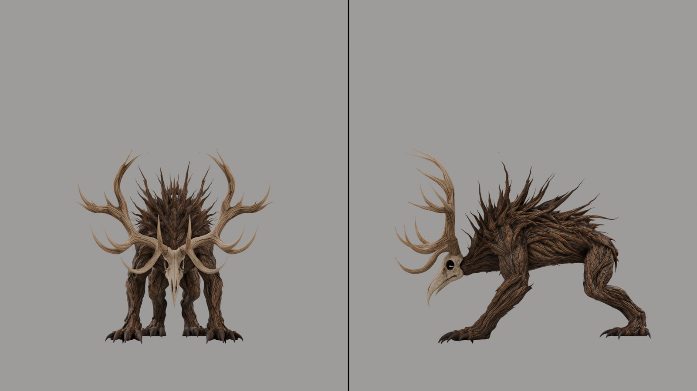
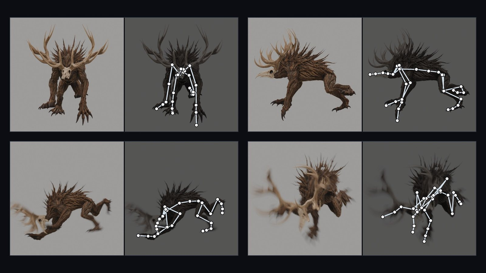
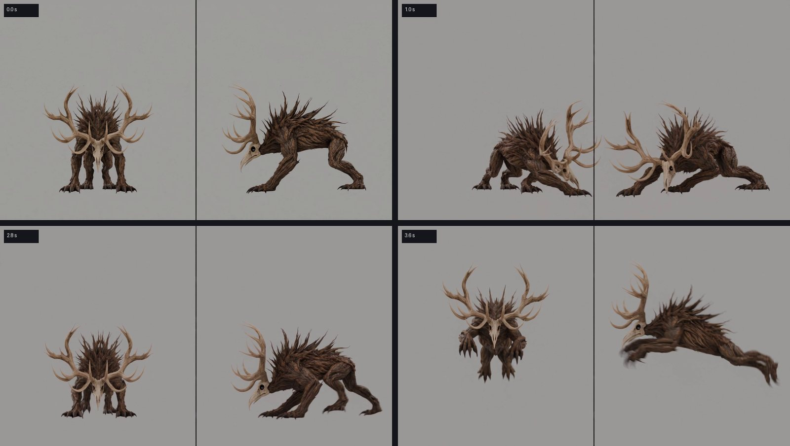
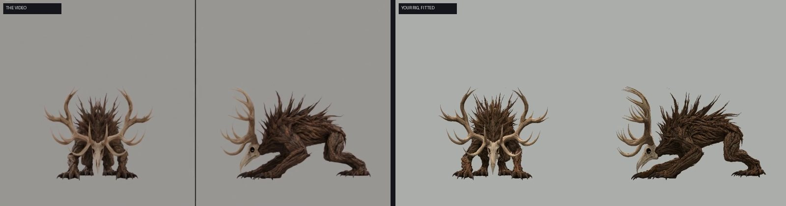

# Tutorial: animate your own monster from an AI video

This is the whole road, in order, for someone who has never used the tool. You start with a 3D model of your creature
and end with a normal Blender animation (an Action) you can export to Unreal, Godot or Unity.

**You do not film anything and you do not bring a video from the internet.** The tool renders one picture of YOUR
model, an AI video generator turns that picture into a short video of the move you describe, and the tool
rebuilds that move on your model's own skeleton. Because the video starts from your exact model, in a pose and under
cameras the tool knows, it can measure every joint in every frame.

The generator is your choice: any image-to-video generator that starts from a given **first frame**. We made and
tested every clip with Seedance (ByteDance), so the examples below are Seedance's; Kling, Veo, Runway, Hailuo and
others with a first-frame mode work the same way in principle.

```
your model ──> skeleton ──> start picture ──> joint reader (once per creature)
                                  │
                                  └──> AI video of a move ──> the tool ──> Blender Action ──> your game
```

How long, the first time (an RTX 4070): install 30-60 min, steps 2-5 about 10 min, the joint reader about 40 min
(once per creature), each move after that: the AI video (Seedance: 5 min to an hour in its queue) + about 2 minutes here.

---

## Step 1. What you need, and installing it (once)

| | |
| --- | --- |
| A computer | Windows 10/11 or Linux, an **NVIDIA graphics card, RTX 30 series or newer** (12 GB tested; 8 GB works for reading, training is slower) |
| Blender | 5.1 (recent 4.x should work), from blender.org |
| Python | 3.11 (3.10-3.12), from python.org |
| ffmpeg | on PATH (Windows: `winget install Gyan.FFmpeg`) |
| git | to download this repository |
| A video generator | image-to-video from a first frame. We used Seedance on Dreamina (CapCut), Topview or the BytePlus API; Kling, Veo, Runway and others have the same mode. Each clip costs credits (a 5 s 720p Seedance 2.5 clip on Dreamina: 185 credits in October 2026) |
| A 3D model of your creature | `.glb`, `.fbx` or `.blend`, textured. With or without bones (step 3 makes bones) |

Install (Windows PowerShell; the same commands with `pip` and `/` paths on Linux):

```powershell
git clone https://github.com/canitcode/video2rig.git
cd video2rig
python -m venv .venv
.venv\Scripts\Activate.ps1
python -m pip install -r requirements.txt
python -m pip install torch --index-url https://download.pytorch.org/whl/cu128     # PyTorch with CUDA
```

Check it: `python -m video2rig -h` prints the commands. Every command below is run from this folder, with the venv
active. Tell the tool where Blender is if it is not at the default place:
`$env:V2R_BLENDER = "C:\Program Files\Blender Foundation\Blender 5.1\blender.exe"`, and add Blender's folder to PATH
so `blender` works in the commands below (or write the full path instead of `blender`).

---

## Step 2. A folder for your creature

One folder per creature. Everything the tool makes for it lands there.

```powershell
mkdir my_beast
Set-Content -Encoding ascii my_beast/creature.json '{}'
```

`creature.json` holds the creature's settings; `{}` (empty) is enough to start. Write it with `-Encoding ascii` as
above: a file saved by Notepad with a byte order mark is not read.

---

## Step 3. A skeleton (skip this if your model already has bones)

A model straight from Tripo, Meshy or a sculpt has no bones. The auto-rig makes them, skins the mesh and saves a
rigged `.blend`, in about five minutes:

```powershell
blender --background --factory-startup --python blender/autorig_prepare.py -- --model beast.glb --out my_beast/autorig
python -m video2rig.autorig.unirig my_beast/autorig
blender --background --factory-startup --python blender/autorig_build.py -- --work my_beast/autorig
```

- The second command uses [UniRig](https://github.com/VAST-AI-Research/UniRig) (MIT) to draw the skeleton. Install it
  once as described in [docs/WORKFLOW.md](docs/WORKFLOW.md) ("Installing UniRig"). Without it, the tool falls back to a
  skeleton from the mesh's centre lines (`python -m video2rig.autorig.skeleton my_beast/autorig`).
- **Look at `my_beast/autorig/poses-sheet.png`**: your model in four test poses. Tearing, or a leg dragging the body
  along, means bad weights: fix them in Blender before you go on.
- The model must stand on the ground, facing along X or Y. Rotate it first if it stands at an angle.
- A creature that should bite or roar needs its mouth modelled a little open: then it gets a jaw bone.

From here on your model is `my_beast/autorig/rigged.blend`.


The pose sheet of the boss in the release video: the skin follows every bone, nothing tears.

**Your model already has bones?** Any armature works (Mixamo, Rigify, Unreal, your own). The tool finds knees and
elbows by their names (`Thigh/Shin`, `UpperArm/Forearm`, `.L/.R` and the common variants); other names can be set in
`creature.json` ([docs/CONFIG.md](docs/CONFIG.md)).

---

## Step 4. Export the rig

Open your model in Blender and pose it the way it should stand in the first frame of every video: a relaxed stance,
arms a little away from the body, feet on the ground. Save. Then:

```powershell
blender my_beast/autorig/rigged.blend --background --python blender/export_rig.py -- --out my_beast/rig
```

- Holding something (a club, a log, a sword)? Make it a separate mesh object and add `--props Club`.
- More than one armature in the file: `--armature NAME`.
- Apply modifiers other than the Armature (mirror, subdivision) before exporting.

---

## Step 5. Render the start picture

This is the picture the video generator will animate. The tool renders it from your model, so it knows exactly where every joint
is in it.

```powershell
blender my_beast/autorig/rigged.blend --background --python blender/render_start.py -- --out my_beast/start --margin 2.0
```

You get `my_beast/start/start.png`: one 1920x1080 picture with **two views side by side, front | side**, on a plain
grey floor, and `cameras.json` (the two cameras). Two views let the tool see depth: whether a claw is in front of the
body or behind it.

- `--margin 2.0` leaves room around the creature for big moves (rearing up, jumps, a pounce). Nothing may leave the
  picture in the video.
- The facing is guessed from the feet; if the side view shows the wrong side, add `--facing -Y` (or `+X`, `-X`, `+Y`).
- Simple moves of a person can use one view: `--views side` or `--views three-quarter`.
- A long, low creature (a snake, a lizard): `--views side,top --widths 1280,640 --margin-wide 1.45` (docs/WORKFLOW.md).



The start picture of the boss in the release video. **The tool makes this picture for you**: you do not draw, pose or
film anything for the video generator.

**Do not change the model, its pose or the cameras after this step.** The start picture is the one moment the tool
knows exactly. If you change any of them, do steps 4-6 again.

---

## Step 6. Teach the tool your creature (once per creature)

The joint reader is a small neural network (Meta's DINOv2-small with a small decoder) that learns to find every joint
of THIS creature in a picture. It learns from thousands of renders of your own model in random poses, through the
same two cameras, so nobody has to mark anything by hand:

```powershell
python -m video2rig.reader.prepare my_beast --blend my_beast/autorig/rigged.blend --steps 9000
```

- It makes 3000 random poses, renders them in Blender in the background (a few minutes), then trains on the graphics
  card. 9000 steps took 35-46 minutes on an RTX 4070. Fewer steps work but read worse; more than ~9000 add nothing.
- When it ends, it prints the reader's error on poses it never trained on (`held_out`, also in
  `my_beast/reader/reader-train.json`): **2-4 px is good**. Much more means something is wrong with the rig or the
  start picture.


- One reader reads every move of this creature. You train again only if the model, the rig or the start picture
  changes.
- Do not skip this step: without a reader the tool falls back to an old, far less accurate method.

---

## Step 7. Make the video (the step that decides everything)

### Where and how

Any image-to-video generator that can start from a given **first frame**. What we used, Seedance:

- **Dreamina** (dreamina.capcut.com): Video, the Seedance model (2.x), image to video with a **first frame**
  ("First and last frames" mode, only the first frame). Upload `my_beast/start/start.png` **as the first frame**, not
  as a reference image.
- **Topview**: image to video with Seedance, `start.png` as the first frame.
- **BytePlus API** (paid per token, no queue): `python -m video2rig.generate my_beast roar --prompt roar.txt` sends the
  start picture itself and saves the clip; set it up as in [docs/VIDEO.md](docs/VIDEO.md).

Settings: **720p** (two views need it; one view can use 480p), **16:9** (the start picture is 1920x1080), **5 seconds**
(4-8 s; 8 s for a combo of several blows). **One move per clip.**

Download the video and save it as `my_beast/clips/roar.mp4`. The file name (here `roar`) is the clip's name for the
tool. Keep the sound if your generator makes one: Seedance's clips come with steps, grunts and impacts that fit the motion (the boss's voice in the video
that introduced this tool came from these clips).



A good clip (the boss's combo, Seedance 2.5, 720p, 5 s): both views do the same thing at the same moment, the
cameras never move, nothing leaves the picture, no dust or sparks.

### The prompt

Write it in this order: what the picture shows, that both views are the same creature at the same moment, the
cameras, the move in short numbered beats, how it ends, and the rules. A template:

```text
Two views of the same moment, side by side, as in the first frame: on the left [YOUR CREATURE, described as it looks
in the picture] seen from the front, facing the camera; on the right the same creature seen from its left side,
facing left. Both views always show the same creature doing the same action at the same instant. Both cameras never
move, never cut, never zoom. Plain grey studio with a flat grey floor, the thin dark divider line stays in place.

[THE MOVE, at full real speed, in numbered beats:] 1) ... 2) ... 3) ... It ends [THE END POSE], in both views, until
the end.

Shot at a very fast shutter speed: no motion blur at all, every frame is sharp, every limb is clearly drawn in every
frame. No visual effects of any kind: no dust, no smoke, no debris, no sparks, no particles, no speed lines, no
motion trails, no camera shake. The same creature as in the first frame (same body, same proportions, same
materials), its whole body stays inside each view the whole time.
```

A real one, the boss's combo from the video (the Leshy K, Seedance 2.5 on Dreamina, 720p, 5 s):

```text
Two views of the same moment, side by side, as in the first frame: on the left the huge hunched beast made of dark
twisted wood fibres, with a crest of long dark wooden thorns along its back, a long pale bird skull with a curved
beak and enormous pale stag antlers, on four long clawed limbs, seen from the front and facing the camera; on the
right the same beast seen from its left side, facing left. Both views always show the same beast doing the same
action at the same instant. Both cameras never move, never cut, never zoom. Plain grey studio with a flat grey floor,
the thin dark divider line stays in place. A furious attack sequence at full real speed: the beast starts low on all
four limbs: 1) it jerks its skull and antlers up and back, pulling its weight onto its hind legs, then snaps forward
and rips one front claw through a fast low swipe just above the floor in front of it; 2) it drops back into a low
tense crouch for half a second; 3) it rears up onto its hind legs to its full height, both front claws raised high
above its antlers, and smashes both claws down onto the floor in front of it with all its weight, the skull and the
antlers whipping down with them; 4) it stays low and creeps forward two slow stalking steps on all four limbs; 5) it
explodes forward in a short pounce of about half its body length, both front claws raking forward, its hind legs
kicking out behind it; 6) it lands low on all four limbs and freezes in a crouch, ready to strike again, until the
end. Every blow is fast and heavy, like a boss in a dark fantasy action game. Shot at a very fast shutter speed: no
motion blur at all, every frame is sharp and crisp, each of the four limbs, the claws, the skull and the antlers are
sharp and clearly drawn in every frame. No dust, no debris, no cracks, no smoke, no glow, no effects. The skull and
the antlers are solid bone and keep their shape. The same beast as in the first frame (same body, same proportions,
same materials), its whole body including all four claws and the antlers stays inside each view the whole time, even
at its full height with the claws raised and after the pounce.
```

This wording worked with Seedance; other generators understand the same plain description.

What we learned about prompts (more in [docs/VIDEO.md](docs/VIDEO.md)):

- Say what each view shows **at the end** ("in both views it ends lying on its back"). Without it the generator
  often rolls the creature back.
- A hit taken: "convulses as if hit, with no visible cause". The words "struck" or "hit" alone make the generator draw
  a club; "an invisible blow" draws a shockwave.
- Effects (dust at every step, sparks on every blow) hide the limbs from the reader. Always end with the no-effects
  sentence.
- A move that loops (a walk, an idle): ask for the end pose to be the start pose.

### Check the clip before you use it

Watch it once and throw it away (generate again) if:

- the two views do not move together (one view a beat late, or a different move in each),
- anything crosses the divider line or leaves the picture,
- something appears that is not there (a weapon, a rock, a shockwave, a second creature), or a part changes size,
- the camera moves, zooms or cuts.

Then let the tool check what your eye can miss (seconds):

```powershell
python -m video2rig check my_beast roar
```

**PASS**: go on. **WARN**: go on, but watch the limbs in step 9. **FAIL**: the two views disagree about where the body
is; no fit can make one true motion out of two different ones. Generate the clip again. A bad clip costs credits
again, but fitting a bad clip costs more: the tool reproduces the video, mistakes included.

---

## Step 8. Turn the video into an animation

```powershell
python -m video2rig run my_beast roar
```

About a minute for a 5 s clip. It finds the clip's real frame rate (generated clips are often not what their file says),
lines up the cameras on the first frame, reads every joint in every frame and both views, decides left from right
where the side view is unsure, fits your skeleton to the joints frame by frame and cleans the motion (one-frame
spikes, jitter). The result is `my_beast/out/roar.npz` and a report in `my_beast/work/roar/report.json`.

No NVIDIA card at hand for this step: `--cpu` reads on the processor (a few minutes instead of seconds).

---

## Step 9. Look at the result

```powershell
python -m video2rig review my_beast roar
```

This makes `my_beast/work/roar/review.mp4`: the video, your skeleton fitted through the same camera, both outlines on
top of each other, and the creature from a three-quarter view the video never had.


 Watch it in motion, not frame by
frame. The three-quarter view is where a wrong depth or a hidden limb shows.

The numbers in the report only point where to look: the outline match per view (0.9 and more is good), the worst
frames, the largest jump of a joint in one frame.

---

## Step 10. Into Blender and your game

```powershell
blender my_beast/autorig/rigged.blend --background --python blender/import_motion.py -- --motion my_beast/out/roar.npz --save my_beast/roar.blend
```

(Or in Blender's Scripting tab: open `blender/import_motion.py`, set `MOTION = r"...\roar.npz"`, run it.)

You get an Action named after the clip: rotation keys at the clip's real times, the root's movement, and props with
their own keys. From here it is a normal Blender animation:

- trim it, retime a phase that is too slow, make a loop, add a few keys where a foot should stay planted;
- export with File > Export > FBX or glTF (Unreal, Godot, Unity), with the clip's sound cut at the same places.

Tips from our boss:

- Generated heavy creatures can float (a leap hangs in the air). Fix it in the Action (retime the hang, lower the
  body), not by generating again.
- A standing foot can slide a few centimetres. Pin it with IK keys in Blender or in your engine.
- One move per clip, then chain them in your game (idle, roar, attack, stagger, death).

---

## When something goes wrong

| What you see | What to do |
| --- | --- |
| `check` says FAIL | the two views drew different moves: generate the clip again |
| A leg is the wrong one (left and right swapped) for a few frames | use two views (front \| side); make sure the side view sees the side `render_start.py` chose |
| The reader's `held_out` error is large (over ~8 px) | the rig or skin is wrong (look at the pose sheet) or the start picture changed after export: redo steps 4-6 |
| The fit is shaky | the clip has motion blur or effects: ask for a fast shutter and no effects; more in [docs/TROUBLESHOOTING.md](docs/TROUBLESHOOTING.md) |
| Out of graphics memory | close games and other GPU programs; [docs/TROUBLESHOOTING.md](docs/TROUBLESHOOTING.md) |
| Blender is not found | set `V2R_BLENDER` to `blender.exe` (step 1) |

---

## Advanced: the dense reader (how the Leshy K in the video was made)

The boss in the video used a newer reader that looks at a window around the body instead of the whole panel: it reads
the joints about 1.5x more exactly. It is experimental: so far it was used on one creature. After steps 1-6:

```powershell
python -m video2rig.reader.poses my_beast --n 6000 --seed 1 --out my_beast/reader/renders-dense/poses.npz
blender my_beast/autorig/rigged.blend --background --factory-startup --python blender/render_poses.py -- --poses my_beast/reader/renders-dense/poses.npz --cameras my_beast/start/cameras.json --out my_beast/reader/renders-dense --copies 12 --samples 8 --fit 896 --height 720 --project my_beast
python -m video2rig.reader.visible my_beast --poses my_beast/reader/renders-dense/poses.npz --out my_beast/reader/renders-dense/visible.npz
python -m video2rig.reader.dense labels my_beast
python -m video2rig.reader.dense train my_beast --init my_beast/reader/reader.pt --steps 8000
```

and for every clip, instead of step 8:

```powershell
python -m video2rig.reader.dense read my_beast roar --locator masks
python -m video2rig.reader.fit my_beast roar --reading my_beast/work/roar/dense/reading.npz --tag=-dense
```

The motion is then `my_beast/out/roar-dense.npz` (step 10 with that file). The method and its measurements:
[docs/HOW-IT-WORKS.md](docs/HOW-IT-WORKS.md).

---

## Read next

- [docs/WORKFLOW.md](docs/WORKFLOW.md): every step in more detail, every option.
- [docs/VIDEO.md](docs/VIDEO.md): start pictures and prompts, Seedance's API road.
- [docs/CONFIG.md](docs/CONFIG.md): `creature.json` (joint names, limits, smoothing).
- [docs/HOW-IT-WORKS.md](docs/HOW-IT-WORKS.md): the method, what it can and cannot see.
- [docs/TROUBLESHOOTING.md](docs/TROUBLESHOOTING.md): memory, timing, wrong legs, sliding feet.
